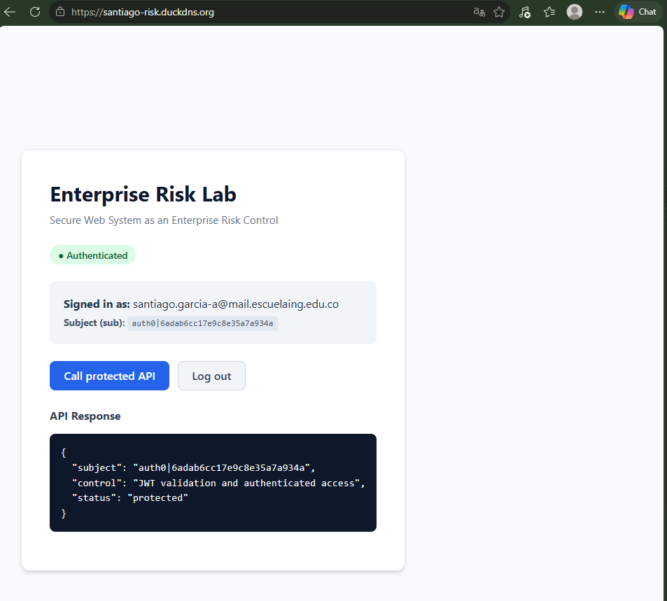
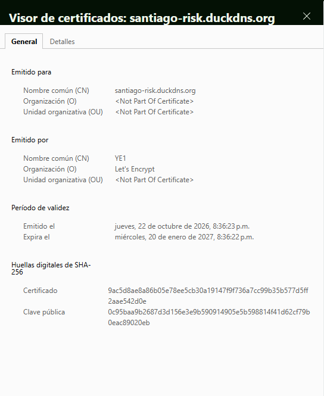
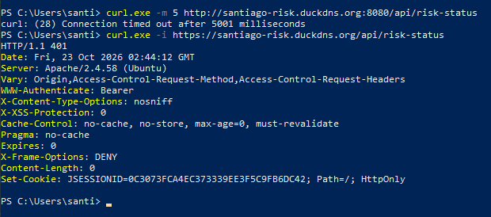

# Secure Web System as an Enterprise Risk Control

This project implements a secure web architecture demonstrating defense-in-depth and enterprise risk controls. The system comprises a React Single Page Application (SPA), identity management and token issuance via Auth0, a Spring Boot backend operating as an OAuth 2.0 Resource Server, and an Apache HTTP Server reverse proxy terminating TLS with a Let's Encrypt certificate behind Duck DNS dynamic DNS.

---

## Deployed Application

- Public Application URL: https://santiago-risk.duckdns.org
- Protected API Endpoint: https://santiago-risk.duckdns.org/api/risk-status

---

## Architecture

```
Browser
  |  (1) Authenticate & Obtain Access Token
  v
Auth0 ------------------------> React Frontend (Vite)
                                      |
                                      | (2) Authorization: Bearer <token>
                                      v
Internet --> Duck DNS --> Apache HTTP Server (Port 443 + TLS)
                                      |
                                      | (3) Reverse Proxy (/api/ -> 127.0.0.1:8080)
                                      v
                               Spring Boot API
                        (OAuth 2.0 Resource Server)
```

---

## Repository Structure

```
.
|-- backend/
|   |-- src/main/java/com/example/risk/
|   |   |-- RiskApplication.java
|   |   |-- RiskController.java
|   |   `-- SecurityConfig.java
|   |-- src/main/resources/
|   |   `-- application.properties
|   |-- mvnw
|   |-- mvnw.cmd
|   `-- pom.xml
|-- frontend/
|   |-- src/
|   |   |-- App.jsx
|   |   |-- index.css
|   |   `-- main.jsx
|   |-- .env.example
|   |-- index.html
|   |-- package.json
|   `-- vite.config.js
|-- deployment/
|   |-- DEPLOY_STEPS.md
|   |-- deploy.sh
|   |-- enterprise-risk-api.service
|   `-- enterprise-risk.conf
|-- docs/
|   |-- README.md
|   |-- authenticated-api-call.png
|   |-- certificate-proof.png
|   `-- port-8080-closed.png
|-- .gitignore
`-- README.md
```

---

## Auth0 Configuration

1. API Configuration:
   - Name: Enterprise Risk Lab API
   - Identifier (Audience): https://enterprise-risk-api
   - Signing Algorithm: RS256
   - Permission / Scope: read:risk (Description: "Read the protected risk status")

2. Single Page Application (SPA):
   - Name: Enterprise Risk Lab Frontend
   - Application Type: Single Page Application
   - Allowed Callback URLs: http://localhost:5173, https://santiago-risk.duckdns.org
   - Allowed Logout URLs: http://localhost:5173, https://santiago-risk.duckdns.org
   - Allowed Web Origins: http://localhost:5173, https://santiago-risk.duckdns.org
   - User-Delegated Access: Under the APIs tab, access is granted to Enterprise Risk Lab API with the read:risk scope.

3. Tenant Domain and Database:
   - Auth0 Domain: dev-pex0h55z20dwvyvt.us.auth0.com
   - Test User: Configured in the Username-Password-Authentication database connection for lab testing.
   - Note: Client secrets are strictly prohibited in SPAs; only the Client ID is used.

---

## Run Locally

### 1. Backend

Configure local properties in `backend/src/main/resources/application.properties` and start the server:

```powershell
cd backend
.\mvnw.cmd spring-boot:run
```

Verify that unauthorized requests are rejected:

```bash
curl -i http://localhost:8080/api/risk-status
# Returns HTTP/1.1 401 Unauthorized
```

Verify that the health check endpoint is reachable without credentials:

```bash
curl http://localhost:8080/actuator/health
# Returns {"status":"UP",...}
```

### 2. Frontend

Create the local environment file from the template:

```powershell
cd frontend
copy .env.example .env.local
```

Set your Auth0 credentials in `frontend/.env.local` (`VITE_API_URL=http://localhost:8080`).

Install dependencies and start the Vite development server:

```powershell
npm install
npm run dev
```

Open http://localhost:5173, authenticate with your Auth0 account, and call the protected API.

---

## Deployment

The production deployment runs on an AWS EC2 instance running Ubuntu 24.04 LTS (t3.micro) associated with Elastic IP 52.45.225.80:

- Dynamic DNS: The Duck DNS subdomain santiago-risk.duckdns.org resolves dynamically to 52.45.225.80.
- Network Hardening: The AWS Security Group and UFW firewall restrict inbound traffic to ports 22 (SSH), 80 (HTTP), and 443 (HTTPS). Internal port 8080 is never exposed to the internet.
- Backend Service: The Spring Boot application is packaged as an executable JAR and managed by systemd as `enterprise-risk-api.service`, executing under a dedicated non-login system user (`riskapi`).
- Web Server & Reverse Proxy: Apache HTTP Server serves the production React build from `/var/www/enterprise-risk-frontend` and proxies `/api/` traffic internally to `http://127.0.0.1:8080/api/`.
- TLS Termination: A valid Let's Encrypt certificate was issued using `certbot --apache -d santiago-risk.duckdns.org`. Automatic renewal was verified successfully via `sudo certbot renew --dry-run`.

For comprehensive deployment instructions, refer to `deployment/DEPLOY_STEPS.md`.

---

## Verification Checklist

- [x] Unauthenticated requests to /api/risk-status return 401.
- [x] A logged-in user can call /api/risk-status from the frontend.
- [x] The backend validates the JWT issuer and audience.
- [x] The application is available at https://santiago-risk.duckdns.org.
- [x] The browser shows a valid certificate and HTTPS lock icon.
- [x] Port 8080 is not reachable from the public internet.
- [x] sudo certbot renew --dry-run succeeds.

---

## Evidence

### 1. Authenticated API Call

Authenticated API call over HTTPS returning status protected and the user subject identifier.

### 2. Valid TLS Certificate

Valid Let's Encrypt certificate issued for santiago-risk.duckdns.org, valid until January 20, 2027.

### 3. Port 8080 Blocked from the Internet

Port 8080 times out from the internet while https://santiago-risk.duckdns.org/api/risk-status returns 401.

---

## Risk-Control Reflection

| Control | Risk Reduced | Evidence |
| :--- | :--- | :--- |
| Auth0 authentication | Impersonation and weak credential handling | Auth0 Universal Login flow, user identity verification, and token issuance |
| JWT validation at the API | Unauthorized API access | HTTP 401 response when accessed without a valid signed token |
| Audience validation | Token reuse against unintended APIs (Confused Deputy) | API strictly rejects tokens unless audience matches https://enterprise-risk-api |
| HTTPS with a valid certificate | Credential, token, or data exposure in transit (MitM attacks) | Let's Encrypt certificate validated by browser lock icon |
| Apache reverse proxy | Direct exposure of the application server port | Only ports 80 and 443 are public; port 8080 is blocked by the AWS Security Group and UFW (connection times out from the internet) |
| Central service logs | Delayed incident detection and insufficient audit trails | Service audit events recorded via journalctl -u enterprise-risk-api |

---

## Security Notes

- Secret Protection: `.env.local`, `.env.production`, private keys (`*.pem`), and the Duck DNS token are strictly excluded by `.gitignore` and never committed.
- Public Client Principles: Single Page Applications operate in an untrusted environment. Only the Client ID is used in the browser; client secrets are never embedded or distributed.
- Origin Restriction: CORS policy explicitly restricts allowed origins to the development server (`http://localhost:5173`) and the production domain (`https://santiago-risk.duckdns.org`).
- Token Hygiene: JWT access tokens are handled in memory by the Auth0 React SDK and forwarded in the `Authorization: Bearer <token>` header; they are never logged or stored in insecure storage.
- Least Privilege: The backend runs as a non-login system account (`riskapi`) with minimal file system permissions.
- System Maintenance: Operating system security updates and TLS renewal monitoring are actively maintained.
